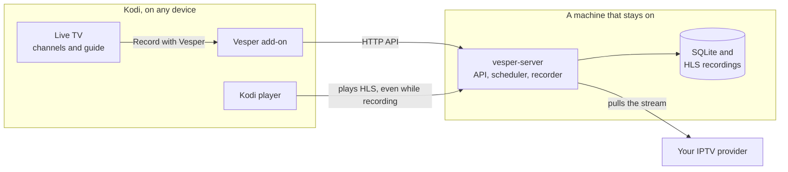

<p align="center">
  
</p>

<p align="center">
  <a href="https://github.com/aminegames125/vesper/actions/workflows/ci.yml"></a>
  <!-- version:start --> <!-- version:end -->
  <a href="LICENSE"></a>
</p>

<p align="center">
  <a href="https://amineos.dev/vesper/">Website</a> ·
  <a href="#how-it-works">How it works</a> ·
  <a href="#quick-start">Quick start</a> ·
  <a href="#lite-or-full-mode">Lite or full</a> ·
  <a href="#requirements">Requirements</a> ·
  <a href="#configuration">Configuration</a> ·
  <a href="#faq-and-troubleshooting">FAQ</a> ·
  <a href="docs/KODI.md">Kodi guide</a> ·
  <a href="docs/SERVER.md">Server guide</a> ·
  <a href="docs/EXTENDING.md">Extending Vesper</a>
</p>

# Vesper

**Record IPTV from Kodi.** Vesper is a Kodi add-on plus a small self-hosted recording server. In Kodi's own Live TV channel list or TV guide you choose **Record with Vesper**. The server, running on a machine that stays on, captures the stream. Later you watch the recording in Kodi, resume where you stopped, and can even start watching while it is still recording.

It does not bring channels of its own. The add-on reads the IPTV providers you already set up in Kodi (PVR IPTV Simple Client) and hands them to your server, so there is nothing to type twice. The server is one Rust binary with a SQLite database and no other services; it runs on Windows, Linux and in Docker.

Website: **[amineos.dev/vesper](https://amineos.dev/vesper/)**

## How it works



1. The add-on finds your server on the network and passes along the playlists from Kodi's Live TV.
2. You pick a channel or a programme and choose **Record with Vesper**.
3. The server pulls the stream and saves it as HLS segments, joining the stream again if it drops.
4. You open **Vesper** under Add-ons in Kodi, pick the recording and play it. Where you stop is saved on the server.

## What you get

| | |
| --- | --- |
| **Record from Kodi's own Live TV** | A **Record with Vesper** entry in the context menu of the channel list, the guide and guide search. A channel records now for 30 min, 1 h, 2 h or until you stop it. A programme records from the guide's times, a minute early and three minutes late, once, every day, every week, or every episode. |
| **Or skip Kodi: use the web** | Open the server's address in any browser, sign in and use **Live TV** under Watch: add an M3U link or Xtream login, browse and search channels, **Watch live**, **Record** now or from the guide, and play your library. Pressing **Record this** while watching keeps what you have seen. See [Live TV in the browser](docs/SERVER.md#live-tv-in-the-browser). |
| **Providers connected for you** | Playlists set up in PVR IPTV Simple Client are sent to the server once and re-checked every 6 hours. Channels are matched by name. |
| **Watch and resume in Kodi** | Continue watching, recording now and coming up, all recordings with folders, your schedules (edit, pause, run now) and a server status screen. Kodi offers to resume; the position is kept on the server. Notifications tell you when a recording starts, finishes or fails. |
| **Plays while it records** | Recordings are HLS, so an item that is still recording can be opened from the start. |
| **Survives a bad stream** | The server rejoins a dropped stream and keeps one recording. A backup address for a channel takes over when the first keeps failing. |
| **Keeps the disk tidy** | Recordings delete themselves after a week by default; change it per recording or keep one forever. Recording is refused when less than 512 MB of disk is free. |
| **Self-hosted** | One binary or one Docker image. No database server. ffmpeg is optional and only adds thumbnails, MP4 export and cutting. |
| **Lite or full** | Lite is for one home network with no login. Full adds users, bearer tokens, quotas, invites and an admin panel for shared or internet-facing servers. |
| **Plugins and extensions** | The server takes plugins in any language (events, new download sources, your own API endpoints) and the Kodi add-on takes extensions from other add-ons, with a Python module and Kodi events. See [Extending Vesper](docs/EXTENDING.md). |
| **HTTP API** | Everything is a plain HTTP call, so you can script it, for example to make a schedule with a custom set of days (see the [server guide](docs/SERVER.md#http-api)). |

## Quick start

### 1. Start the server

Pick one. The server listens on port `8484`.

**Docker Compose** (recommended):

```yaml
# docker-compose.yml
services:
  vesper:
    image: ghcr.io/aminegames125/vesper-server:latest
    restart: unless-stopped
    ports:
      - "8484:8484"
    volumes:
      - vesper-data:/data
    environment:
      VESPER_MODE: lite

volumes:
  vesper-data:
```

Save it and run `docker compose up -d`. A full-mode version with an administrator and a reverse proxy is in the [server guide](docs/SERVER.md#docker-compose).

**Binary**: download the archive for your system from the [latest release](https://github.com/aminegames125/vesper/releases/latest) (Windows x64, Linux x64, Linux arm64), unpack it and run:

```bash
./vesper-server --mode lite
```

Open `http://<that machine>:8484/admin/` to check that it is up.

> Lite mode has no login. Keep it on your home network. For anything shared or reachable from outside, use `--mode full` behind HTTPS; see [lite or full](#lite-or-full-mode).

### 2. Install the add-on in Kodi

1. Download [`repository.vesper-1.0.0.zip`](https://amineos.dev/vesper/kodi/repository.vesper/repository.vesper-1.0.0.zip) (on a TV box, open the address in its browser or copy the file over with a USB stick).
2. In Kodi: **Settings > System > Add-ons**, turn on **Unknown sources**.
3. **Add-ons > Install from zip file**, pick the zip.
4. **Add-ons > Install from repository > Vesper repository > Video add-ons > Vesper > Install.**

The repository keeps the add-on up to date. You can also install `plugin.video.vesper-<version>.zip` from the [latest release](https://github.com/aminegames125/vesper/releases/latest) the same way, without automatic updates. Details and a no-network option are in the [Kodi guide](docs/KODI.md#install).

About 20 seconds after Kodi starts, the add-on looks for your server and connects the IPTV providers from Kodi's Live TV. If you run a full-mode server, enter the username and password in the add-on settings (or create an account there with an invite code).

### 3. Record

Open **TV > Channels** or **TV > Guide**, open the context menu on a channel or programme (hold OK, or `C` on a keyboard) and choose **Record with Vesper**. Watch it under **Add-ons > Video add-ons > Vesper**.

## Lite or full mode

| | Lite (`--mode lite`, default) | Full (`--mode full`) |
| --- | --- | --- |
| Meant for | One household on a trusted network | Several people, a shared box, or anything reachable from outside |
| Login | None. Anyone who can reach the port can record, sync and open the admin panel. | Username and password; bearer tokens (30 days by default) |
| Accounts | One implicit owner | Roles `admin`, `user`, `guest` (guests cannot record) |
| Limits | None | Per account: recordings at once, longest recording, storage, retention |
| Joining | n/a | `closed`, `invite` or `open`, set in the admin panel |
| Admin panel | Open to the network | Administrator sign-in |
| Network guard | Answers only to home-network host names and refuses requests from other websites | Normal; private addresses refused for the recorder unless an admin allows them |
| HTTPS | Not needed on a LAN. Never expose it publicly. | Put Caddy, nginx or similar in front and add `--trust-proxy` |
| Kodi settings | Nothing to enter | Server address (or discovery), username and password |

Full mode is the supported way to run Vesper outside a home network. Setup is in the [server guide](docs/SERVER.md#full-mode-setup) and the add-on side in the [Kodi guide](docs/KODI.md#full-mode-sign-in).

## Requirements

| Part | Supported | Notes |
| --- | --- | --- |
| Kodi | 19 (Matrix), 20 (Nexus), 21 (Omega) | Plain Python add-on (`xbmc.python` 3.0.0), so it should work on Android TV, Fire TV, LibreELEC, CoreELEC, Windows, Linux and macOS. See [what is tested](docs/KODI.md#what-is-tested-and-what-is-not). |
| IPTV in Kodi | PVR IPTV Simple Client with a remote M3U link | Local-file playlists and other PVR add-ons cannot be read by the server. |
| Server, binary | Windows x64, Linux x64, Linux arm64 | Built by the release workflow. macOS is not built. |
| Server, Docker | `ghcr.io/aminegames125/vesper-server` | Multi-arch image (amd64 and arm64, so Raspberry Pi and ARM NAS boxes work), with ffmpeg and a health check. A ready-made full-mode [`docker-compose.yml`](docker-compose.yml) is in the repository root; see the [server guide](docs/SERVER.md#docker-compose). |
| Disk | Space for your recordings | Streams are saved as they arrive, without re-encoding, so size follows your provider's bitrate. |
| Optional | ffmpeg on the server's `PATH` | Adds thumbnails, MP4 export and cutting. |

To build from source you need Node 22+, pnpm 10+ and stable Rust; the Kodi tests need Python 3.

## Configuration

Server options can be given as flags or environment variables. Full list and examples: [server guide](docs/SERVER.md#options).

| Flag | Environment | Default | Meaning |
| --- | --- | --- | --- |
| `--mode` | `VESPER_MODE` | `lite` | `lite` has no logins. `full` has users, roles and quotas. |
| `--bind` | `VESPER_BIND` | `0.0.0.0:8484` | Address and port to listen on. |
| `--data-dir` | `VESPER_DATA_DIR` | `data` | Database (`vesper.db`) and recordings. Back this folder up. |
| `--admin-user`, `--admin-password` | `VESPER_ADMIN_USER`, `VESPER_ADMIN_PASSWORD` | none | Create the first administrator on start (full mode). Otherwise `/admin/` shows a setup screen. |
| `--allow-private` | `VESPER_ALLOW_PRIVATE` | off | Let the recorder and proxy reach private network addresses. Always on in lite mode. |
| `--trust-proxy` | `VESPER_TRUST_PROXY` | off | Read the client address from a reverse proxy's `X-Forwarded-For`. |
| `--allowed-host` | `VESPER_ALLOWED_HOSTS` | none | Extra host names a **lite** server answers to (comma separated). |
| `--no-discovery` | `VESPER_NO_DISCOVERY` | off | Do not announce the server on the network (mDNS `_vesper._tcp`). |
| `--wake-command` | `VESPER_WAKE_COMMAND` | none | Command run when the next scheduled start changes; the time is in `VESPER_NEXT_START`. |

Add-on settings (in Kodi): server address, username and password (full mode only), ask to resume, and play with InputStream Adaptive. See the [Kodi guide](docs/KODI.md#settings).

## FAQ and troubleshooting

**The add-on says it cannot find a server.** Discovery uses mDNS, which guest Wi-Fi, some VPNs and Docker's default bridge network block. Type the address in the add-on settings (`192.168.1.20:8484`), using the machine's network address, not `localhost`. With Docker, `network_mode: host` on Linux makes discovery work.

**"This server needs a username and password."** The server is in full mode. Enter an account's username and password in the add-on settings. Guests cannot record.

**A channel is "not in a provider Vesper knows".** Vesper matches Kodi's channel name against the playlists on the server. Make sure the provider is an M3U link in PVR IPTV Simple Client, then run **Connect my Kodi IPTV providers now** in the add-on settings.

**Can I record from Tvheadend, Zattoo or another PVR add-on?** No. Those add-ons do not expose stream addresses the server could pull. Add the provider's M3U link to PVR IPTV Simple Client instead.

**A recording stutters in Kodi.** Turn on **Play recordings with InputStream Adaptive** in the add-on settings.

**HTTPS with a self-signed certificate.** The add-on checks the certificate by default. For your own server, turn off **Check the HTTPS certificate** in the add-on settings. A publicly trusted certificate (Caddy gets one automatically) needs no change.

**Can I make a daily or weekly schedule from Kodi?** Yes: on a programme in the guide choose *Record every day* or *Record every week*, or *Record every episode*. The add-on needs your time zone for that (it detects it, or set it in the add-on's advanced settings). Other day patterns go through the [HTTP API](docs/SERVER.md#schedules).

**Where are the recordings?** In `<data dir>/recordings`, as folders of `.ts` segments with an `index.m3u8`. Back up the whole data folder.

More in the [Kodi guide](docs/KODI.md#troubleshooting) and the [server guide](docs/SERVER.md).

## Roadmap

Ideas, none of them started or promised:

- More testing on real Kodi installs: Android TV, Fire TV, LibreELEC, Kodi 19 and 20.
- A picker for custom repeat days inside Kodi.

Have a use case? Open a [feature request](https://github.com/aminegames125/vesper/issues/new?template=feature_request.yml).

## Contributing

Bug reports with your Kodi version, system, server mode and add-on version are the most useful thing you can send. Code changes: see [CONTRIBUTING.md](CONTRIBUTING.md). Security problems: [SECURITY.md](SECURITY.md). Questions: [SUPPORT.md](SUPPORT.md). Everyone is expected to follow the [Code of Conduct](CODE_OF_CONDUCT.md).

Commits follow [Conventional Commits](https://www.conventionalcommits.org). Every push to `main` that passes the checks is released automatically; the [changelog](CHANGELOG.md) records what is in each release.

Vesper records only what you add yourself and ships no channels or playlists. Use it for content you have the right to record.

## Licence

MIT. See [LICENSE](LICENSE).

## History

Vesper started as an IPTV player and then grew Android and Android TV apps. It is now only the Kodi add-on and the recording server. The full earlier project, apps included, is kept on the [`old-full-app`](https://github.com/aminegames125/vesper/tree/old-full-app) branch.
