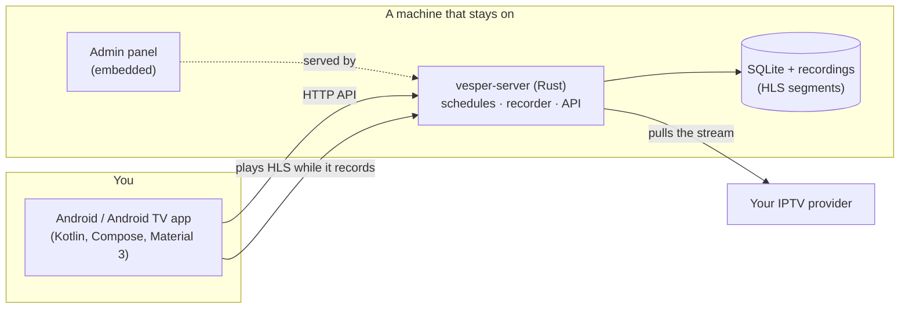

<p align="center">
  
</p>

<p align="center">
  <a href="https://github.com/aminegames125/vesper/actions/workflows/ci.yml"></a>
  <!-- version:start --> <!-- version:end -->
  <a href="LICENSE"></a>
</p>

<p align="center">
  <a href="#-what-it-does">What it does</a> ·
  <a href="#-quick-start">Quick start</a> ·
  <a href="#-the-android-app">Android app</a> ·
  <a href="#-the-server">Server</a> ·
  <a href="#-api">API</a> ·
  <a href="#-how-it-fits-together">Architecture</a> ·
  <a href="#-develop">Develop</a>
</p>

# Vesper

**Tell it a channel and a time, and it records.** "Channel 7, every weekday, 11:00 to 11:30." Vesper's server does the recording on a machine that stays on, and a native Android or Android TV app is the remote control: set it up on the sofa, watch the recording tonight.

Vesper is a **recorder, not a player**. It uses your own IPTV playlist (an M3U link or an Xtream login), and it does one job well.

- **Record now** or **schedule** it: once, daily, weekdays, weekends or on the days you pick.
- **Native Android and Android TV app.** Material 3, the system's own colours, no webview. One APK for phone, tablet and TV.
- **A server for Linux and Windows** (and Docker). One small binary, no ffmpeg, no database to install.

## ✨ What it does

| | |
| --- | --- |
| **Record now** | Pick a channel, choose 30 min, 1 h, 2 h, 3 h or *until I stop it*, and it starts at once. |
| **Schedules** | A start time on a date, with repeats. The time is kept on your wall clock, so 11:00 stays 11:00 when the clocks change. |
| **Start early, stop late** | Padding of up to an hour on each side, so you never miss the first minutes of a programme that runs over. |
| **Survives a bad stream** | If the stream drops, the server joins it again and keeps **one** recording you can play start to finish. |
| **Warns before it fails** | A clash with another recording is flagged when you save, and a nearly full disk stops a recording with a clear reason instead of leaving an empty file. |
| **Watch while it records** | Recordings are HLS, so you can open one on any device **while it is still being recorded**. |
| **Keep or tidy up** | Keep recordings until you delete them, or for 1, 7 or 30 days. |
| **Your channels, on the server** | Add an M3U link or an Xtream login once. Your provider login stays on the server, not on every phone. |
| **Notifications** | The app tells you when a recording finishes or fails, and a webhook (Discord, ntfy, Slack-style) can too. |
| **Keep only the newest** | A schedule can keep just its last 1, 3, 5 or 10 episodes and tidy the rest. |
| **Run now, duplicate, pause all** | Start a schedule's channel at once, copy a schedule, or pause every schedule for a holiday. |
| **Rename, search, clear failed** | Tidy the recordings list from the app. |
| **Favourite and test channels** | Star the channels you use and check that a stream answers before you schedule it. |
| **Server status** | Settings shows the server's free disk and what records next. |
| **Accounts, if you want them** | *Lite* mode is for one home. *Full* mode adds users, quotas, invites and an admin panel. |

## 🚀 Quick start

### 1. Run the server

Download a build from the [latest release](https://github.com/aminegames125/vesper/releases/latest) (Windows, Linux x64 or Linux arm64), or use Docker:

```bash
docker run -d --name vesper --restart unless-stopped \
  -p 8484:8484 -v vesper-data:/data \
  ghcr.io/aminegames125/vesper-server:latest
```

Or run it from source (needs Node 22, pnpm and Rust):

```bash
pnpm install
pnpm --filter @vesper/admin build
cargo run -p vesper-server -- --mode lite
```

It listens on port `8484`. **Lite mode has no login, so keep it on your home network.** For a server on the internet use `--mode full` behind HTTPS (see the [server guide](docs/SERVER.md)).

### 2. Install the app

Download `Vesper-…-android.apk` from the [latest release](https://github.com/aminegames125/vesper/releases/latest) and install it on your phone, tablet or Android TV. (On a TV, sideload it with *Downloader* or `adb install`.)

### 3. Record something

1. Open the app and enter the server address, for example `192.168.1.20:8484`.
2. **Recordings → Record now** (or **Settings → Add a playlist**): paste your M3U link or Xtream login when asked.
3. Tap the red dot beside a channel to record it now, or the calendar to schedule it for a time and a repeat.
4. Watch it under **Recordings** whenever you like, even while it is still recording.

## 📱 The Android app

Everything on screen is a standard Material 3 component, so it looks like part of your phone. On Android 12 and later it picks up your wallpaper colours.

| Screen | What you do there |
| --- | --- |
| **Schedule** | See what records next, and the schedules that make it. Pause, edit or delete a schedule. |
| **Pick a channel** | Search your playlist, filter by group, then tap the red dot to record now or the calendar to schedule. |
| **New schedule** | Date, start time, length, repeat, padding and how long to keep it. Warnings show before you leave. |
| **Recordings** | What is recording (with progress), what is coming up, and what is ready to watch. Stop, cancel, delete, play. |
| **Settings** | Server, storage used, playlists, notifications, sign out. |

**On a TV** the same app switches to a side rail, larger text and a dark screen. Date and time are set with simple steps instead of a calendar, which is hard to drive with a remote. Playback uses the system player, which works with the remote's buttons.

> Notifications come from the app checking in with the server, and Android does that at most every 15 minutes, so a notice can arrive a little after the recording ends.

Build it yourself:

```bash
cd apps/android
./gradlew :app:assembleDebug :app:testDebugUnitTest
```

## 🖥 The server

One binary, one data folder (a SQLite database and your recordings).

```bash
vesper-server --mode lite                          # no accounts, for a home network
vesper-server --mode full --bind 127.0.0.1:8484    # accounts, quotas, admin panel
```

| Option | Environment | Default | Meaning |
| --- | --- | --- | --- |
| `--mode` | `VESPER_MODE` | `lite` | `lite` has no logins. `full` has users, roles and quotas. |
| `--bind` | `VESPER_BIND` | `0.0.0.0:8484` | Address and port to listen on. |
| `--data-dir` | `VESPER_DATA_DIR` | `data` | Database and recordings. Back this folder up. |
| `--admin-user` / `--admin-password` | `VESPER_ADMIN_USER` / `VESPER_ADMIN_PASSWORD` | – | Create the first administrator on start (full mode). |
| `--allow-private` | `VESPER_ALLOW_PRIVATE` | off | Let the server reach private network addresses. Always on in lite mode. |
| `--trust-proxy` | `VESPER_TRUST_PROXY` | off | Read the client address from a reverse proxy's `X-Forwarded-For`. |
| `--allowed-host` | `VESPER_ALLOWED_HOSTS` | – | Lite mode only answers to home-network names (an address, `localhost`, `nas`, `*.local`). List other names here, comma separated. |

In **full** mode each account has limits: recordings at once, the longest recording, storage, and how long recordings are kept. The admin panel at `/admin/` shows users, invites, every recording and schedule, an activity log and settings.

<p align="center">
  
  
</p>

More in the **[server guide](docs/SERVER.md)**: Docker, systemd, a reverse proxy with HTTPS, modes and security notes.

## 🔌 API

Everything the app does is a plain HTTP call, so you can script it. Record a channel right now until you stop it:

```bash
curl -X POST http://localhost:8484/api/v1/recordings \
  -H 'content-type: application/json' \
  -d '{"title":"Evening news","url":"http://provider.example/live/news.ts","seconds":0}'
```

Record it every weekday at 11:00 for 30 minutes, starting a minute early and stopping two minutes late:

```bash
curl -X POST http://localhost:8484/api/v1/schedules \
  -H 'content-type: application/json' \
  -d '{
    "title": "Morning news",
    "url": "http://provider.example/live/news.ts",
    "tz": "Europe/Paris",
    "start_time": "11:00",
    "seconds": 1800,
    "days": 31,
    "start_date": "2026-11-02",
    "pad_before": 60,
    "pad_after": 120
  }'
```

`days` is a bit mask (Monday is 1, Sunday is 64): `31` is weekdays, `127` every day, `0` once. In full mode add `-H 'Authorization: Bearer <token>'`. The reply to a schedule includes `warnings` if it clashes with something. The [server guide](docs/SERVER.md#http-api) lists every endpoint, and `packages/cloud-client` is a typed TypeScript client for it.

## 🧩 How it fits together



| Path | What it is |
| --- | --- |
| `apps/server` | The server: API, scheduler, recorder jobs, retention, accounts (Rust, axum, SQLite). |
| `crates/vesper-recorder` | Records HLS and raw streams to disk. No ffmpeg, no platform code. |
| `apps/android` | The native Android and Android TV app (Kotlin, Jetpack Compose). |
| `apps/admin` | The admin panel, built into the server binary (React, Tailwind). |
| `packages/cloud-client` | A typed TypeScript client for the server API. |

The scheduler keeps the next two weeks of every repeating schedule as ordinary recordings, so each one can be cancelled on its own. [Architecture notes](docs/ARCHITECTURE.md).

## 🔒 Security

- **Lite mode has no login.** Use it on a home network and never expose it to the internet.
- **Full mode** hashes passwords with Argon2id, stores only a hash of each session token, and rate limits failed sign-ins.
- **Your provider login lives on the server** (in the playlist source and in stream addresses). Run the server yourself and protect its data folder.
- The server refuses private network addresses unless you allow them, and re-checks every redirect, so a public server cannot be used to probe your network.

## 🛠 Develop

You need Node 22+, pnpm 10+ (pnpm only), a recent stable Rust and, for the app, JDK 17 with the Android SDK.

```bash
pnpm install
pnpm lint          # Biome and clippy
pnpm test          # Turborepo and cargo tests
cd apps/android && ./gradlew :app:assembleDebug :app:testDebugUnitTest
```

Commits follow [Conventional Commits](https://www.conventionalcommits.org). Every push to `main` that passes the checks is released automatically: `feat:` makes a minor release, `fix:` and the rest a patch, and a `!` or `BREAKING CHANGE` a major one. The [changelog](CHANGELOG.md) records what is in each.

## 🗺 Not built yet

- A programme guide (XMLTV), so you can pick a show instead of a time.
- Push notifications that arrive the moment a recording ends.
- Recording the same programme only once when two people ask for it.

The earlier IPTV **player** (desktop, web and Android) is kept on the [`old-vesper`](https://github.com/aminegames125/vesper/tree/old-vesper) branch.

## Licence

MIT. See [LICENSE](LICENSE).
