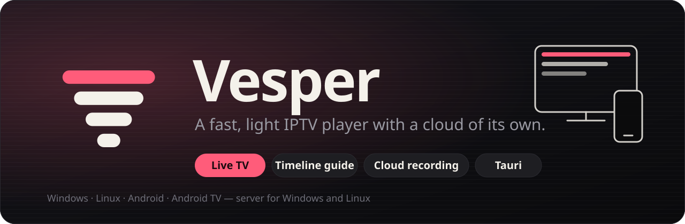
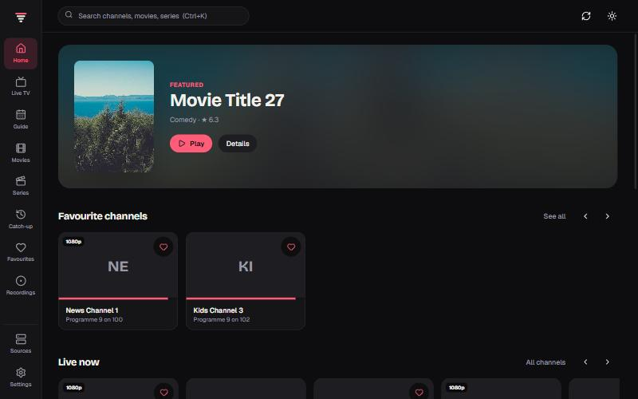
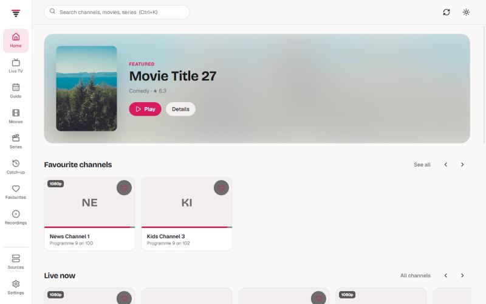
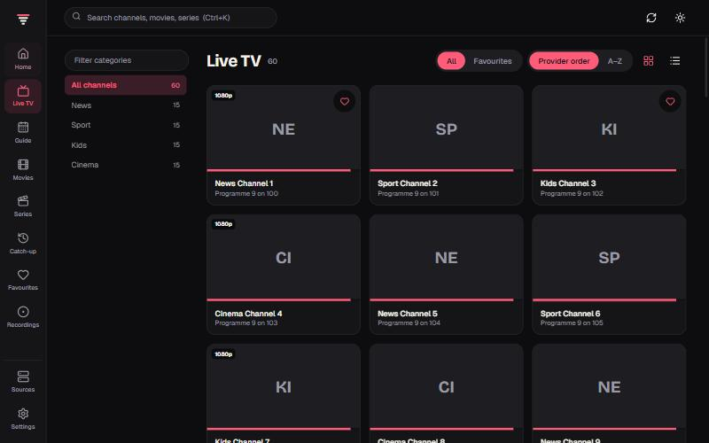
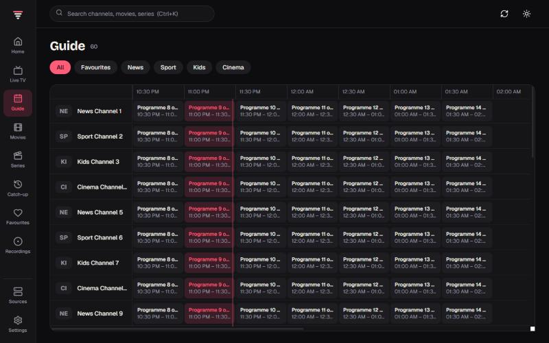
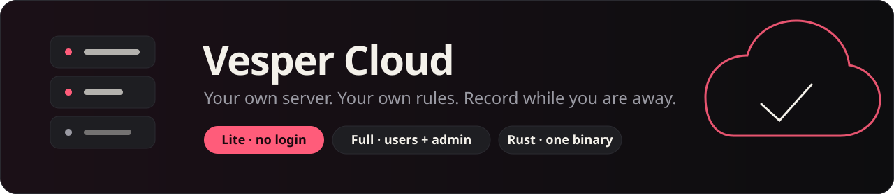
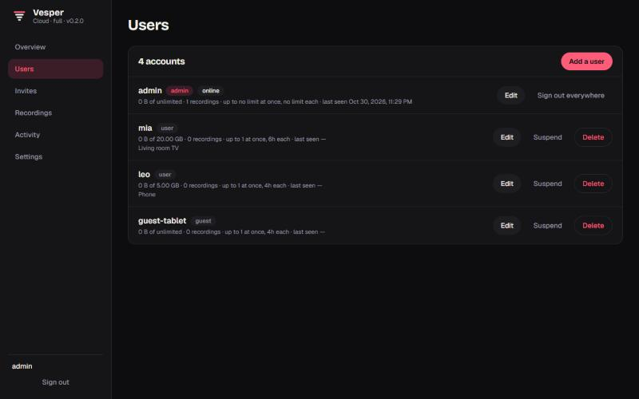
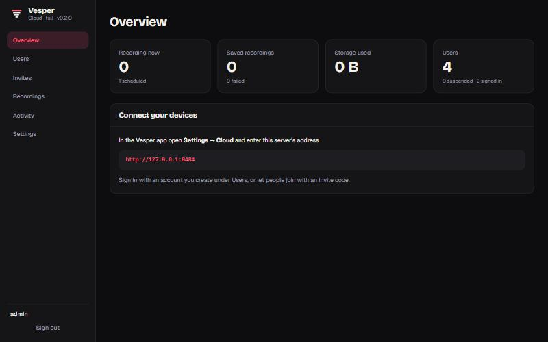
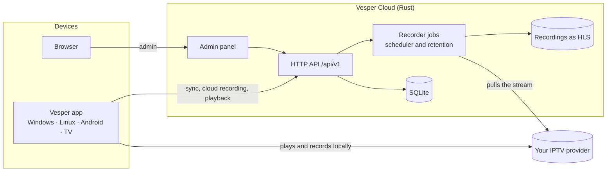
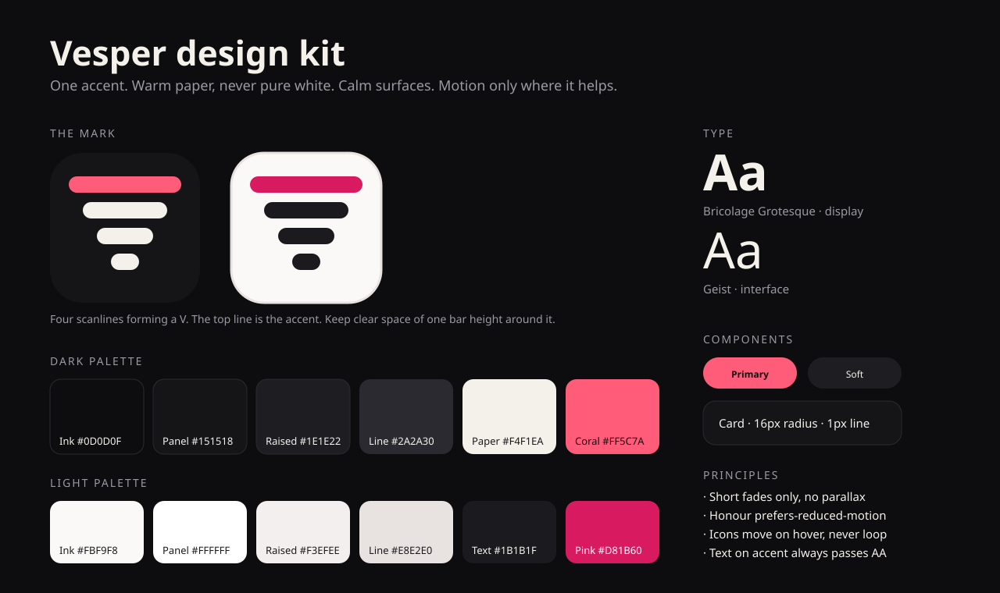

<p align="center">
  
</p>

<p align="center">
  <a href="https://github.com/aminegames125/vesper/actions/workflows/ci.yml"></a>
  <a href="https://github.com/aminegames125/vesper/releases/latest"></a>
  <!-- version:start --><!-- version:end -->
  <a href="LICENSE"></a>
  <a href="https://github.com/aminegames125/vesper/stargazers"></a>
</p>

<p align="center">
  
  
  
  
  
  
  
  
  
  
</p>

<p align="center">
  
  
  
  
  
</p>

<p align="center">
  <a href="#-quick-start">Quick start</a> ·
  <a href="#-features">Features</a> ·
  <a href="#%EF%B8%8F-vesper-cloud">Vesper Cloud</a> ·
  <a href="#%EF%B8%8F-platforms">Platforms</a> ·
  <a href="docs/SERVER.md">Server guide</a> ·
  <a href="docs/ARCHITECTURE.md">Architecture</a> ·
  <a href="#%EF%B8%8F-develop">Develop</a>
</p>

---

**Vesper** is an IPTV player that stays out of your way. It starts fast, uses a few tens of megabytes instead of a few hundred, and gives you live TV, a real timeline guide, movies, series, catch-up and recording in a calm, cinema-first interface with dark and light themes.

When one device is not enough, add **Vesper Cloud**: a small server you run yourself, written in Rust. It records while your devices are off, keeps favourites and "continue watching" in sync, and lets you watch your recordings on the phone, the TV or a browser. Run it **lite** (no logins, for your home network) or **full** (users, roles, quotas, invites and an admin panel).

> [!NOTE]
> Vesper ships **no channels** and plays only streams you have the right to watch. You bring an Xtream Codes login or an M3U playlist.

<p align="center">
  
  
</p>
<p align="center">
  
  
</p>

## ⚡ Quick start

### 1. Get the app

Download the installer for your device from the [latest release](https://github.com/aminegames125/vesper/releases/latest):

| Device | File |
| --- | --- |
| Windows | `Vesper_…_x64-setup.exe` or `.msi` |
| Windows (MSIX) | download the `.msix`, the `.cer` and `Install-Vesper.cmd` into one folder and double-click `Install-Vesper.cmd`; it trusts the certificate and installs (fixes error 0x800B010A) |
| Linux | `.AppImage`, `.deb` or `.rpm` |
| Android phone or tablet | `Vesper-…-android.apk` (allow installing from your browser or file manager) |
| Android TV / Google TV / Fire TV | the same APK; sideload it with *Downloader* or `adb install` |

Open **Sources**, add your Xtream login or M3U link, and you are watching. New here? **Try free public channels** on the welcome screen loads a legal public playlist.

### 2. Optional: run your own cloud

The desktop app already contains the server. Open **Settings → Cloud → Run a server on this PC** and press *Start*, or run it on a box that is always on:

```bash
# Linux or Windows: download vesper-server from the release, then
./vesper-server --mode lite                  # no accounts, great for a home network
./vesper-server --mode full                  # accounts, quotas and the admin panel

# Docker
docker run -d --name vesper -p 8484:8484 -v vesper-data:/data ghcr.io/aminegames125/vesper-server:latest
```

Then open `http://<server>:8484/admin/`. In every Vesper app, go to **Settings → Cloud**, enter the address and connect. That is all.

## ✨ Features

<table>
<tr>
<td width="50%" valign="top">

### The player
- **Home** with continue watching, favourites, live now, new movies, top series
- **Live TV** by category, grid or list, search, A–Z, favourites
- **Guide** as a timeline grid with a "now" line; watch, record or schedule from any programme
- **Movies & Series** with detail pages, seasons, episodes and resume
- **Catch-up** for channels whose provider keeps an archive
- **Player**: channel zapping, quality, picture fit, speed, picture-in-picture, volume, keyboard shortcuts
- **Dark and light themes**, or follow the system
- **Animated icons** by [AnimateIcons](https://animateicons.in) that play on hover
- **Phone layout** with a bottom bar, **TV mode** with remote-friendly focus

</td>
<td width="50%" valign="top">

### Recording, everywhere
- **On this device**: built-in recorder, **no ffmpeg needed** (Rust on Windows and Linux, Kotlin on Android and Android TV)
- **In the cloud**: the server records even when your devices are off
- **Scheduled**: pick a future programme and the cloud starts it for you, with a minute of padding either side
- **Stay for less**: cloud recordings can delete themselves after 6 hours, a day, a week, or never
- **Watch while recording**: cloud recordings are HLS, so any device can start watching before it ends
- **Download** a finished recording as one `.ts` file
- **Live-edge capture** and duration limits that follow the stream, not the clock

</td>
</tr>
<tr>
<td valign="top">

### Sources
- **Xtream Codes** with account status, expiry and connections
- **M3U** links, side by side with Xtream
- Live, movies, series and catch-up from the same source
- Optional sync of sources between your devices

</td>
<td valign="top">

### Sync
- **Favourites**, **continue watching** and **sources** follow you to every device
- Per-account on the server, last write wins, nothing to configure
- Turn each kind of sync on or off

</td>
</tr>
</table>

## ☁️ Vesper Cloud

<p align="center">
  
</p>

One small Rust binary with SQLite built in. No database to install, no runtime to manage.

| | **Lite** | **Full** |
| --- | :---: | :---: |
| Cloud recording and scheduling | ✅ | ✅ |
| Retention ("stay for less") | ✅ | ✅ |
| Sync across devices | ✅ | ✅ |
| Watch recordings on any device | ✅ | ✅ |
| Proxy for streams that block web views | ✅ | ✅ |
| Logins and passwords (Argon2) | – | ✅ |
| Roles: admin, user, guest | – | ✅ |
| Quotas per user: storage, hours, simultaneous recordings | – | ✅ |
| Invite codes and open or closed registration | – | ✅ |
| Suspend people, sign them out everywhere | – | ✅ |
| Activity log | – | ✅ |
| **Admin panel** | overview, recordings, settings | everything |
| Best for | your own network | family, friends, a public server |

<p align="center">
  
  
</p>

**You decide who does what.** In full mode you create accounts or hand out invite codes, choose each person's role and limits, suspend anyone who looks suspicious, and see what happened in the activity log. Lite mode has none of that on purpose: it is the simplest thing that works when you trust everyone on the network.

Read the [server guide](docs/SERVER.md) for configuration, the HTTP API, systemd and reverse-proxy examples, and the security notes.

## 🖥️ Platforms

| | App | Server |
| --- | :---: | :---: |
| Windows (x64) | ✅ | ✅ |
| Linux (x64) | ✅ | ✅ |
| Linux (arm64) | – | ✅ |
| Android | ✅ | – |
| Android TV | ✅ | – |
| macOS | ❌ | ❌ |
| iOS / iPadOS | ❌ | – |

macOS and iOS are intentionally **not built**: the maintainer does not own Apple hardware and will not ship software that cannot be tested. The Rust crates are portable, so a community build is welcome, but there is no official one.

Each desktop installer **includes the server**, so the app can host your cloud without a second download.

## 🧱 Under the hood



The recorder is a single Rust crate, [`vesper-recorder`](crates/vesper-recorder), used by **both** the app (phones, TVs and desktops) and the server. A recording behaves the same everywhere, and nothing depends on ffmpeg.

```text
vesper/
├── apps/
│   ├── app/            Tauri 2 + React 19 desktop app (Windows, Linux)
│   │   └── src-tauri/  Rust shell: local recording, bundled server control
│   ├── admin/          React admin panel, built into the server binary
│   └── server/         vesper-server: axum + SQLite
├── crates/
│   └── vesper-recorder/  HLS and raw stream recorder shared by app and server
├── packages/
│   └── cloud-client/   typed client for the server API, shared by app and admin
├── brand/              logo, banners, design kit
├── docs/               server guide, architecture, Android notes
└── .github/workflows/  CI and release pipelines
```

More in [docs/ARCHITECTURE.md](docs/ARCHITECTURE.md).

## 🛠️ Develop

The repository is a **pnpm + Turborepo** monorepo with a Cargo workspace. **pnpm is required**: `npm` and `yarn` are blocked on purpose.

```bash
corepack enable                 # gives you the right pnpm
pnpm install

pnpm desktop                    # desktop app with the bundled server (needs Rust)
pnpm dev                        # the app in a browser at http://localhost:1420
pnpm server:lite                # run the server in lite mode
pnpm server:full                # run the server in full mode

pnpm build                      # turbo: admin panel, app, client
pnpm test                       # turbo + cargo test
pnpm lint                       # biome + clippy
```

You need Node 22+, pnpm 10+ and a recent stable Rust. On Windows install the *Visual Studio C++ Build Tools*; on Linux the [Tauri prerequisites](https://tauri.app/start/prerequisites/). The Android app is a separate native Kotlin project in `apps/android`; see [docs/ANDROID.md](docs/ANDROID.md).

### Releases

Every push to `main` is versioned automatically by [`version.yml`](.github/workflows/version.yml): it picks the next number from the commit messages (`feat:` is a minor bump, `feat!:` a major one, everything else a patch), updates every config, this README and the changelog, tags the commit and starts the release. Put `[skip ci]` in a commit message to skip it. Pushing a tag such as `v0.3.1` by hand runs [`release.yml`](.github/workflows/release.yml): it builds the Windows and Linux installers (server inside), the Android APK (TV-ready), the server for Windows, Linux x64 and Linux arm64, a Docker image on GHCR, then publishes one GitHub release with checksums.

## 🎨 Design

Dark and light themes share one palette: ink, warm paper and a single coral accent. Short fades only, `prefers-reduced-motion` honoured, icons that move only when you touch them. The mark is a **V** made of four scanlines.

<p align="center">
  
</p>

## 🗺️ Roadmap

- XMLTV guide for M3U sources
- Per-user parental controls and channel hiding on the server
- Server-side transcoding profiles for weak devices
- Remote-control pairing between a phone and a TV
- Community macOS and iOS builds (not planned by the maintainer)

Have an idea? [Open a feature request](https://github.com/aminegames125/vesper/issues/new?template=feature_request.yml).

## 🙏 Credits

- Animated icons: [AnimateIcons](https://animateicons.in) (MIT)
- Built on [Tauri](https://tauri.app), [axum](https://github.com/tokio-rs/axum), [hls.js](https://github.com/video-dev/hls.js), [React](https://react.dev), [Tailwind CSS](https://tailwindcss.com), [Zustand](https://github.com/pmndrs/zustand)
- Fonts: [Bricolage Grotesque](https://github.com/ateliertriay/bricolage) and [Geist](https://vercel.com/font)
- Vesper began as a rewrite of [ViviPlayer](https://github.com/Spacymineos/viviplayer), which stays archived as it was. No code is shared; this repository starts a fresh history.

## 📄 Licence

[MIT](LICENSE). Contributions are welcome, see [CONTRIBUTING.md](CONTRIBUTING.md). Found a security problem? Please read [SECURITY.md](SECURITY.md) first.
