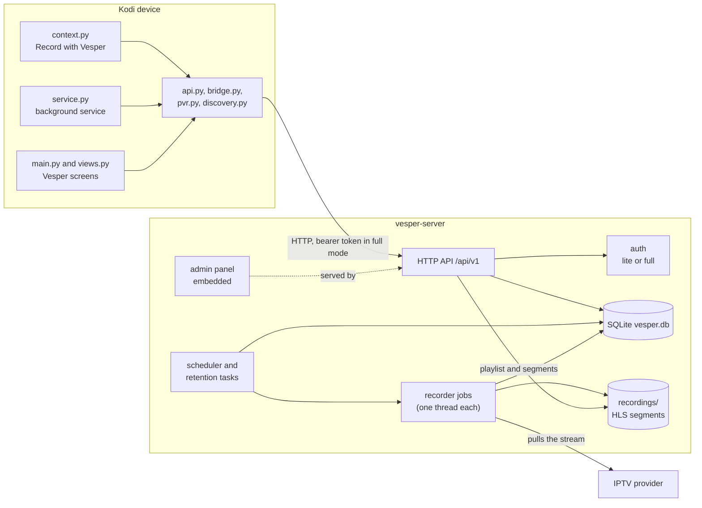
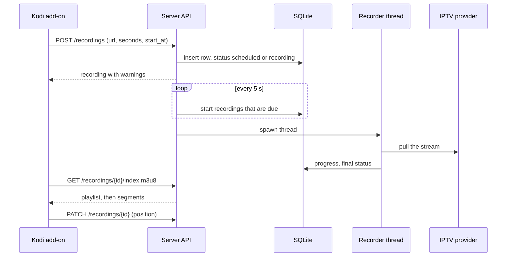

# Architecture

Vesper is two things that talk over HTTP: a **Kodi add-on** (Python) on the device with the TV, and a **server** (Rust) on a machine that stays on. The repository is a pnpm and Turborepo monorepo with a Cargo workspace; JavaScript and Rust meet in one place, the admin panel embedded into the server binary.



## Packages

| Path | Language | What it is |
| --- | --- | --- |
| `apps/kodi/plugin.video.vesper` | Python (Kodi add-on) | The add-on: context-menu entry, background service, screens. Standard library only; the HTTP client and the mDNS discovery are written by hand because Kodi's Python has no extra packages. |
| `apps/kodi/repository.vesper` | Kodi repository add-on | Points Kodi at the add-on catalogue published with the website, so the add-on installs and updates itself. |
| `apps/server` | Rust (axum, rusqlite) | `vesper-server`: API, recorder jobs, scheduler, retention, accounts, admin panel hosting. |
| `crates/vesper-recorder` | Rust | Records HLS and raw streams to a segment folder. No ffmpeg, no platform code. |
| `apps/admin` | TypeScript (React) | Admin panel. Built to static files and **embedded into the server binary** with `rust-embed`. |
| `packages/cloud-client` | TypeScript | Typed client for the server API, used by the admin panel. |
| `apps/site` | TypeScript (React) | The website at [amineos.dev/vesper](https://amineos.dev/vesper/); the Kodi repository is published beside it. |

Turborepo orders the JavaScript tasks (`build`, `typecheck`, `test`); the admin panel builds before the server so it can be embedded. Cargo handles Rust. The add-on is tested with Python's `unittest` and needs neither Kodi nor a server for that.

## The Kodi add-on

- **`context.py`** is the **Record with Vesper** entry. Kodi runs it from the context menu of the TV channels, guide and search windows. It reads the item under the cursor, asks Kodi's JSON-RPC (`PVR.GetBroadcastDetails`) for the programme's times (UTC) and calls the server.
- **`service.py`** starts with Kodi. After about 20 seconds it finds the server (if no address is saved) and syncs providers, then every 6 hours. It also watches playback of Vesper recordings and saves the position to the server when you stop.
- **`views.py`** draws the **Vesper** screens under Video add-ons: continue watching, recording now and coming up, recordings, schedules. `route` picks a function by the `action` query parameter.
- **`pvr.py`** reads the settings files of PVR IPTV Simple Client (one `instance-settings-N.xml` per playlist on Kodi 21, a single `settings.xml` before) to find remote playlist addresses, and matches Kodi channel names to server channels.
- **`api.py`** is the client. It has no Kodi imports. In full mode it signs in, keeps the token in the add-on's data folder and asks the server for a media token to put in the playback address.
- **`discovery.py`** sends one mDNS question for `_vesper._tcp.local.` and parses the replies.

## Auth

- **Lite:** every request is the one implicit administrator. A guard answers only to home-network host names and refuses cross-site requests (see [the server guide](SERVER.md#lite-and-full-mode)).
- **Full:** the add-on posts the username and password to `/auth/login` and gets a bearer token. The server stores only the SHA-256 of tokens in `sessions`. Playback requests carry a separate media token in the query string, because Kodi's player cannot send headers on every segment request.

## Recording

`vesper-recorder` records HLS and raw streams with blocking HTTP over rustls, so it has no dependency on ffmpeg or the platform.

```text
record(options, stop_flag, on_progress) -> Summary
  Output::Segments(dir)   segNNNNN.ts + index.m3u8
```

- **HLS source:** follow the playlist, pick the best variant of a master playlist (preferring variants with audio built in), start at the live edge, append each new segment once, stop when the requested duration is captured.
- **Raw source** (a `.ts` URL): copy bytes, cutting a new segment about every 10 seconds on a 188-byte packet boundary.
- The segment sink rewrites `index.m3u8` atomically after each segment and adds `#EXT-X-ENDLIST` when done, so a player can open the recording while it is being written.
- A bad segment is skipped; a fatal error after some data was captured still keeps what was recorded.

## Server



- **State:** one SQLite connection behind a mutex, in WAL mode; queries are short. The lock is not re-entrant, so handlers compute anything that needs the database *before* taking it.
- **Jobs:** each recording runs `vesper-recorder` on its own OS thread and writes progress and the final status to the database. Stop is an atomic flag. If the server restarts mid-recording, the recording is marked failed and what was captured is kept.
- **Background task:** every 5 seconds start due recordings; every 60 seconds delete expired ones. A schedule keeps the next two weeks of occurrences as ordinary rows.
- **Network safety:** `net::check_target` resolves hosts and refuses private ranges unless allowed; the proxy follows redirects manually and checks each hop.
- **Discovery:** `discovery.rs` announces `_vesper._tcp` with the mode and version as text records (`--no-discovery` turns it off).

## Storage

```text
<data dir>/
  vesper.db          accounts, sessions, sources, schedules, recordings, settings
  recordings/<id>/   segNNNNN.ts and index.m3u8
  crash/             crash reports the server wrote itself
```

Deleting a recording removes its folder. Retention (`keep_hours`) is applied by the background task.

## Releases

`ci.yml` checks every push: Biome, TypeScript, tests, builds, `cargo fmt`, `clippy`, cargo tests, and the Kodi add-on tests. `release.yml` runs on a version tag and publishes the server archives, the Kodi add-on zip and a Docker image to one GitHub release. `pages.yml` publishes the website and the Kodi repository to GitHub Pages. `scripts/bump-version.mjs` is the single source of truth for the version number.
